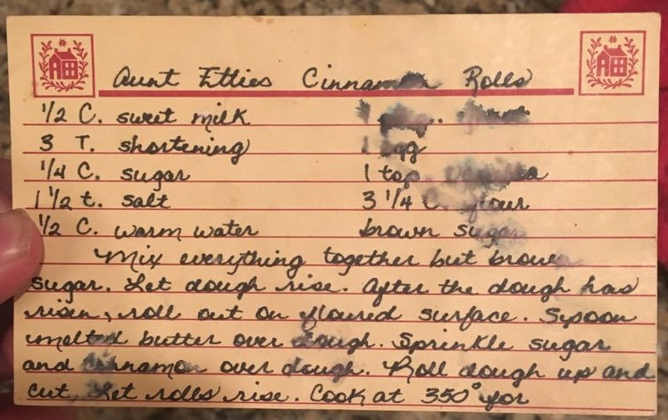
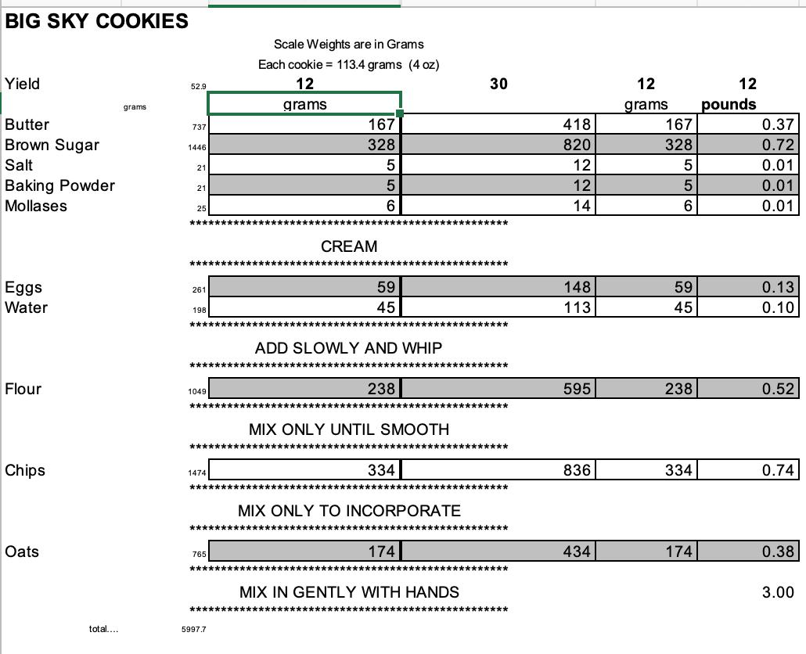
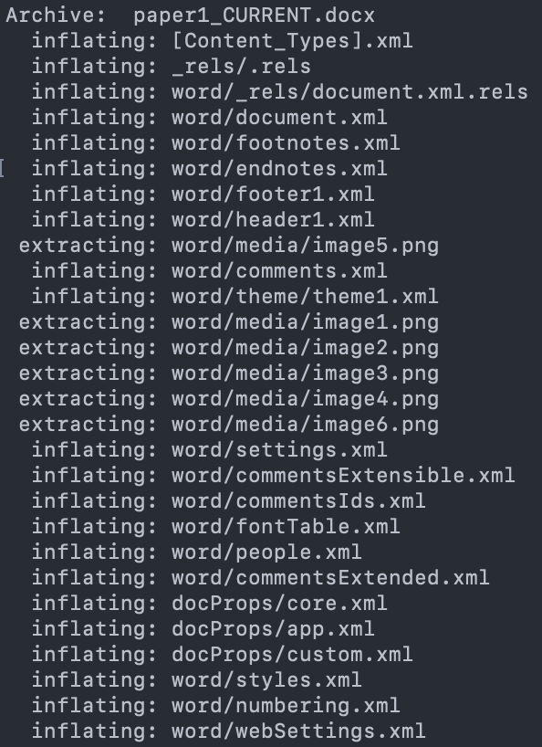
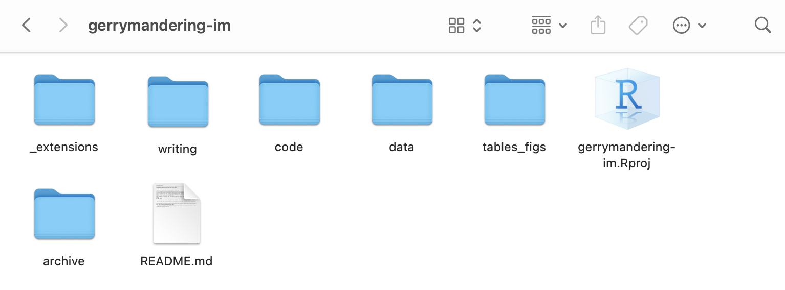
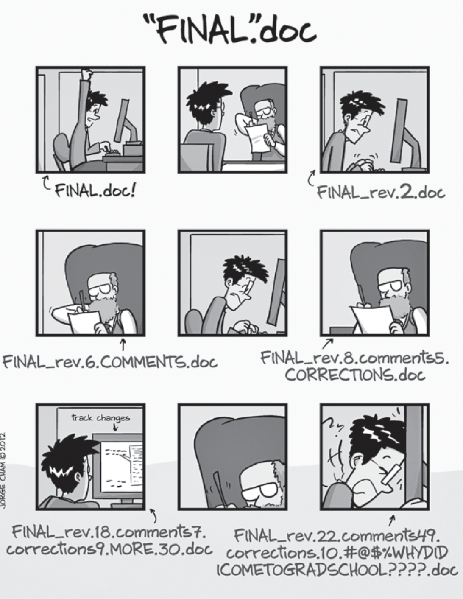
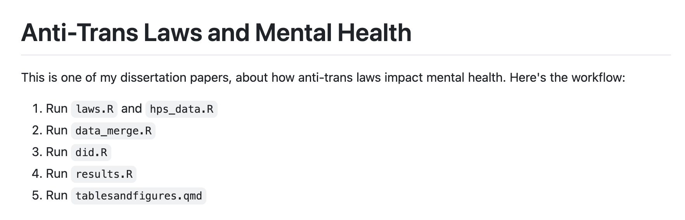

```{r}
#| label: setup
#| echo: false
#| message: false
#| warning: false

library(here)
```


## What is a "workflow"?

::: fragment
I like to think of a workflow like a recipe. It tells you how to go from separate ingredients to a finished, hopefully edible dish.
:::

## 



## 



## In the social science context

::: incremental
- **Ingredients**: data, references
- **Kitchen appliances**: programming software, reference management software, writing/presenting software
- **Final dish**: a research paper or presentation
:::

## What is a *good* project workflow?

::: incremental
- Self-contained and readable
- Stored somewhere safe
- Able to be changed and updated without losing past versions
:::

## By the end of today: {background-image="images/anyone can cook.jpg" background-opacity=20%}

::: {.incremental}
1.  **Your pantry will be organized: ** You will have a coherent system of file management for your project.
2.  **Your cookbook will be laminated:** You will employ some kind of backup for your important files.
3.  **You will make a test batch:** You will use some kind of version control for your project.
:::

## Part I: File Management

## Why it matters

. . .

Your computer is made of files!

. . .

Nothing exists without them.

. . .

Even this presentation is a group of files.

. . .

```{r}
#| echo: true
here()
```

. . . 

```{r}
#| echo: true
dir(here())
```

. . .

```{r}
#| echo: true
dir(here("slides"))
```

. . .

```{r}
#| echo: true
dir(here("slides", "images"))
```


## Down the rabbit hole... {.smaller}

. . .

Even some things we think of as "files" are actually multiple files in a trench coat.

. . .

For example, take a Word document. Here's the Word document for one of my dissertation papers:


. . .

This is actually a zipfile in disguise. Here's what happens when I unzip it:

. . .

{width=300}

## The key

. . .

Things get really complicated, really fast. 

. . . 

Having an easy-to-understand file system will go a long way - and the person who will benefit the most from it is YOU.

## Here's what I do



## Organizing your pantry {background-image="images/anyone can cook.jpg" background-opacity=20%}

::: incremental
1. Put all of the relevant files for your project in one folder

2. Subdivide the folder into separate boxes

:::


## Part II: Backups & Storage

## Why it matters

It doesn't...until it does.

## Two basic options

. . .

1. Storing on your computer or another physical device you own

. . .

::: {.r-stack}

::: {.fragment .absolute left=0}
2. Storing in the cloud
:::

::: {.fragment .absolute left=0}
2. Storing ~~in the cloud~~ on someone else's computer
:::

:::

## Laminating your cookbook {background-image="images/anyone can cook.jpg" background-opacity=20%}

::: incremental
1. Open Box
2. Upload the folder you just created into Box
:::


## Part III: Version Control

## Why it matters {.smaller}

. . .

Science is iterative.

. . .

Sometimes you have to try something to realize it won't work.

. . .

Sometimes you go down a rabbit hole and wish you hadn't.

. . .

Sometimes your advisor asks you to do something you already did five months ago.

. . .

Sometimes you make mistakes!

## Basic Test Batch: Save As

. . .

Instead of saving over your previous work, you save a new copy of the document you were working on, with a new name that reflects the version it is.

. . .

But...


## Basic Test Batch: Save As

{.r-stretch}

## Basic Test Batch: Software with version control built in

. . .

Google Docs, for example, keeps previous versions that you can revert to.

. . . 

However, this can get clunky as well: Google Docs will merge old versions to save space, and if you don't rename your Google Doc regularly, finding the exact previous version can be hard.

. . .

I suggest using a combination of the two.


## BEWARE!
. . . 

NEVER write over the original data file.

. . .

{right=0}


## Making Your Test Batch {.smaller background-image="images/anyone can cook.jpg" background-opacity=20%}
. . .

**Google Docs enjoyers**

. . .

- Name your working document with a meaningful suffix ("filename_current" or "filename_working")

. . .

- Make a copy

. . .

- Rename it "filename_v1" / "filename_date"

. . .

**Microsoft Word enjoyers**

. . . 

- Name your working document with a meaningful suffix ("filename_current" or "filename_working")

. . .

- Save As

. . . 

- Name the new document "filename_v1" / "filename_date"


## Advanced Test Batch: Git & GitHub {.smaller}

. . .

Git is a software that takes a "screenshot" of your project (called a "commit") whenever you ask it to, and saves it to an archive, called a "repository." You can go back to previous versions of a repository whenever you like, and even branch off without losing anything.

. . .

GitHub is a website that integrates with Git and stores your repository online. You can share GitHub repositories with other people and they can download everything (called "pulling") to work on it separately on their own machine, and then upload their changes to the central repository (called "pushing"). 


## Garnishing the dish (concluding thoughts)

## The README file: a meta-recipe {.smaller}
. . . 

The README file gives someone picking up your recipe all the information they need to make the dish the way YOU made it.

. . .

Here's a very basic example from my own dissertation work:

. . . 



. . . 

You can use the README to keep track of decisions you make about your project. It's somewhat analagous to the qualitative research concept of "memoing."


## To AI or not to AI? {.smaller}

Here are some specific contexts in which I think it *might* be useful:

::: incremental
- You're just starting out or continuing on a project, and you ask an AI tool to help you create the "scaffolding" - a directory of folders contained within a single project folder that will have everything you need to reproduce the project.
- You've completed a project, and ask an AI tool to produce a README file that explains in what order to run which codefiles, etc.
- You've completed a project, and ask an AI tool like GitHub Copilot to attempt to run your project from scratch to make sure everything works.
:::

## AI is a sharp knife!

{.absolute top="0" right="0" width="250"}

. . .

Here are three things I would never do:

::: incremental
1.  Allow an AI tool to alter, reorganize, or delete files on my computer
2.  Copy and paste results from an AI tool into my terminal shell
3.  Upload my project into a public chatbot
:::


## Questions

## Thanks for coming!

:::: {.columns}

::: {.column width="50%"}
Questions didn't get answered?

{width=40%}
:::

::: {.column width="50%"}
Take this 2-minute survey to help me out:

{width=40%}
:::

::::

## Resources

## Project Management

::: incremental
- Zotero: free reference management software
- Obsidian: free note-taking software which stores your notes locally
- RStudio, Emacs, VSCode, Positron: IDEs (Integrated Development Environments); some are free
:::


## Backups

::: incremental
- Box, Drive: (mostly) free Cloud storage options
- Zotero web archive: free, backs up your references to the Cloud
- External hard drives: getting cheaper by the day
- Git/GitHub: free storage up to a certain size, also good for version control
- Backblaze: $10/month, backs up your whole computer regularly & automatically

:::

## Version Control

::: incremental
- [Happy Git with R](https://happygitwithr.com/)
- GitHub's [introduction for new users](https://github.blog/developer-skills/github/github-for-beginners-your-roadmap-to-mastering-the-github-essentials/)
- [Stata with Github](https://medium.com/the-stata-guide/stata-and-github-integration-8c87ddf9784a)
:::

